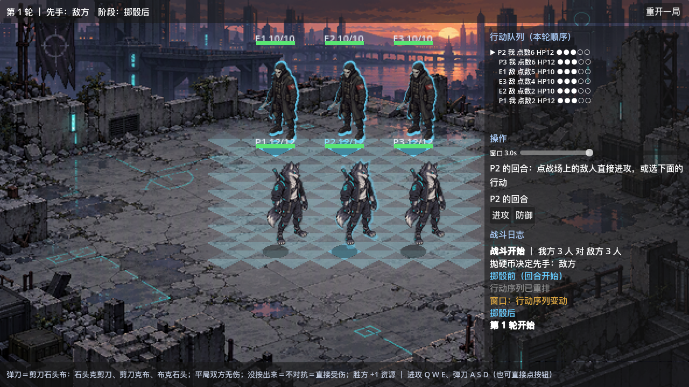
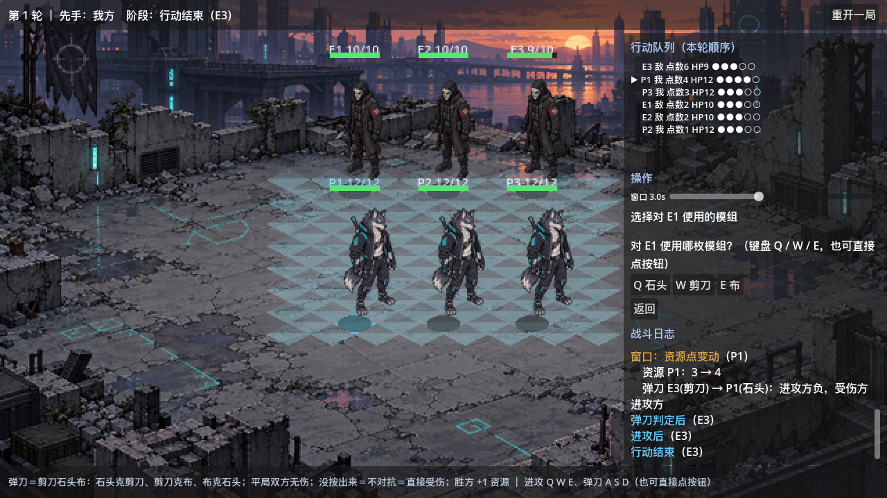
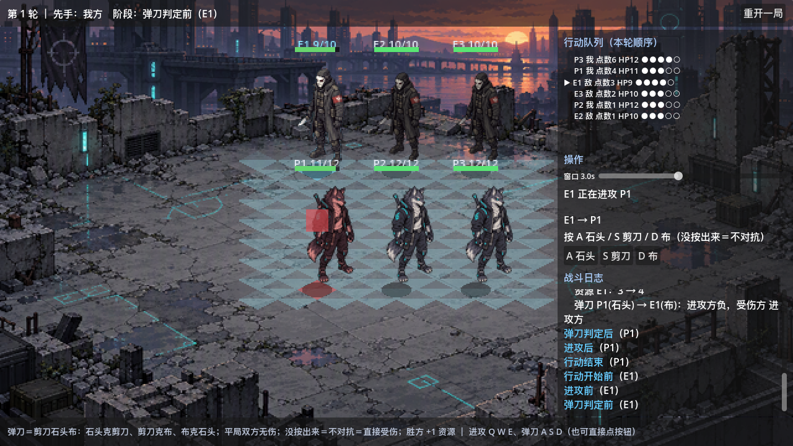

# 玩法原型骨架

按 [`gameplay_prototype.md`](gameplay_prototype.md) 落地的可运行骨架：**先验证"这套规则跑起来对不对、好不好玩"**，
数值用占位值，美术用占位资源。



*当前状态：斜 45° 等距战场，3v3 正面对峙（我方在下、敌方在上）。P3 的回合，
**三个敌人全部亮起青色轮廓描边**——这是"可以直接点它"的提示；点敌人即隐含"我要进攻这个目标"，
不必先按「进攻」。底部常驻弹刀规则条，右侧为行动队列（含 HP 与资源点）与战斗日志。*



*选定目标后进入选模组，按钮显示 `Q 石头 / W 剪刀 / E 布`；此时敌人的"可点"描边已经收起。*



*弹刀演出定格在 62%：敌方 E2 泛白起手后，方块沿等距方向飞向 P1，P1 精灵泛红、脚下红色警示菱形。
此时按钮切换为 `A 石头 / S 剪刀 / D 布`——**进攻与弹刀用两套键位**。*

---

## 一、目录结构

```
core/                     与玩法无关的基础能力
  iso_grid.gd             等距坐标换算（纯数学，战斗与箱庭共用）
  shaders/
    unit_outline.gdshader 单位描边：按纹理 alpha 输出纯色，用作"可以点"的提示
features/battle/          战斗逻辑，全部 extends RefCounted，不依赖场景树
  battle_phase.gd         15 个阶段枚举 + 管线顺序 + 连携窗口判定
  battle_unit.gd          参战单位：阵营、站位、生命值、资源点
  battle_dice.gd          行动顺序骰子
  action_queue.gd         行动队列 + 单指针
  clash_resolver.gd       弹刀结算
  chain_arbiter.gd        连携窗口与子弹时间接口（暂无技能注册）
  battle_controller.gd    回合循环入口
tests/                    自动化测试，extends SceneTree，退出码即结果
  helpers/assert_helper.gd
  test_iso_grid.gd        等距投影、逆运算、菱形场地与深度排序
  test_action_queue.gd    排序优先级与指针语义
  test_dice.gd            面数规则与固定点数特例
  test_clash.gd           弹刀胜负平与不对抗
  test_battle_flow.gd     整场闭环、阶段顺序、资源收支、可复现性
  test_battle_screen.gd   可玩场景冒烟：站位几何 + 自动扮演玩家跑完整场
  test_battle_input.gd    真实输入链路：命中几何 + 提示色 + 事件路由（鼠标用例需真实窗口）
playgrounds/              手工验证场景
  battle_sandbox.tscn     逻辑流水沙盒（按钮推进，打印阶段与弹刀）
  battle_screen.tscn      可操作战斗场景（可玩闭环，当前主场景）
assets/                   美术资源
  raw/                    AI 原始大图（.gdignore，不进资源管线）
  characters/ tiles/ backgrounds/   处理后的游戏规格资源
tools/                    离线美术工具（Python）与截图工具（GDScript）
  process_art.py          原始大图 → 游戏规格（裁边、缩放、程序生成 tile）
  mock_battle.py          等距摆位假想图，验证规格是否成立
  compare_scale.py        精灵尺寸对照实验
  capture_screen.gd       离屏截图，可把攻击演出定格到指定进度
```

设计取向：**逻辑与表现分离**。`BattleController` 不引用任何节点，因此可以无头确定性地跑完整场战斗，
自动化测试与 UI 复用同一套逻辑；`features/battle/` 内**不放任何场景与节点脚本**，这条约束是它可无头测试的前提。
**表现层整体重写为等距场景时，`features/battle/` 与 `tests/` 零改动**——这条约束的价值已经兑现。

---

## 二、规格书 → 模块映射

| 规格书 | 落点 |
| --- | --- |
| §一 3VN、术语 | `BattleUnit`（`Team` / `slot`）、`ActionQueue` |
| §二 回合与行动结构 | `BattleController.begin_round` / `run_action` / `run_round` |
| §三 骰子与排序 | `BattleDice`、`ActionQueue._compare` |
| §三 指针语义 | `ActionQueue.current` / `advance` / `_resync_pointer` |
| §四 资源点 | `BattleUnit.RESOURCE_INITIAL / RESOURCE_MAX`、`BattleController._gain_resource` |
| §五 行动二选一 | `BattleController.ActionChoice`、`_run_attack_begin` / `_run_defend` |
| §六 弹刀 | `ClashResolver` |
| §七 阶段连携 | `ChainArbiter`、`BattleController.window_opened` |
| §八 阶段清单 | `BattlePhase.Id` / `PIPELINE_ORDER` / `WINDOW_IDS` |
| §九 技能影响队列 | `ActionQueue.swap` / `move` / `remove` |
| 可玩闭环 | `BattleScreen`（`playgrounds/battle_screen.gd`） |

**决策注入**：`action_choice_provider`、`target_provider`、`attacker_symbol_provider`、`defender_symbol_provider`
四个 `Callable` 决定"谁打谁、出什么模组"。默认行为是全体进攻 + 等概率随机，接 UI 或 AI 时替换即可。

**定点拆分（玩家输入的接法）**：GDScript 会把含 `await` 的函数静态标记为协程并要求调用方 `await`，
一旦引入就传染整条调用链（测试、UI、`_ready`），所以控制器保持**全同步**，只在"等对抗模组"这一个点上切开：

| 调用 | 作用 |
| --- | --- |
| `begin_action(actor)` | 走到弹刀判定前停下；此后 `has_pending_clash()` 为真 |
| `resolve_attack(symbol)` | 用指定模组结算，补齐弹刀判定后与进攻后 |
| `resolve_attack_auto()` | 用默认策略结算（敌方出模组、自动战斗） |
| `end_action(actor)` | 收尾，进入行动结束 |

`run_action(actor)` = 上面三步的组合，供自动战斗与测试使用。`BattleScreen` 因此可以完全同步地推进流程，
**限时反应窗口的计时放在 UI 层**（`BattleScreen._process`），不污染逻辑层。

**技能接入点**：`BattleController` 广播 `phase_entered`（管线阶段）与 `window_opened`（任意时刻窗口），
技能的触发阶段通过 `ChainArbiter.register_triggers` 注册；只要某阶段存在候选，就该阶段开启子弹时间。

---

## 三、运行与验证

```bash
# 引擎（PATH 上没有 godot 命令，需写全路径）
GODOT="/d/SDK/Godot/Godot_v4.7.2-stable_win64.exe/Godot_v4.7.2-stable_win64_console.exe"

# 新增脚本后先导入，否则 class_name 解析不到
"$GODOT" --headless --path . --import

# 单文件语法校验
"$GODOT" --headless --path . --script res://features/battle/battle_controller.gd --check-only

# 测试套件，退出码 0 通过
"$GODOT" --headless --path . --script res://tests/test_battle_flow.gd

# 可玩场景（已是主场景，也可直接按 F5）
"$GODOT" --path . res://playgrounds/battle_screen.tscn

# 逻辑流水沙盒
"$GODOT" --path . res://playgrounds/battle_sandbox.tscn

# 离屏截图（不要加 --headless，空渲染器拿不到图像）
# 参数依次为：场景、输出、预热帧数、演出定格进度（<0 表示不定格）、目标状态（reaction / symbol / choice）
"$GODOT" --path . --resolution 1280x720 --script res://tools/capture_screen.gd -- \
  res://playgrounds/battle_screen.tscn res://tmp_preview/screen.png 20 0.62 reaction
```

沙盒实测日志顺序（一次进攻行动）：

```
掷骰前（回合开始） → 窗口:行动序列变动 → 掷骰后
行动开始前 → 进攻前 → 弹刀判定前 → 窗口:资源点变动 → 弹刀 → 弹刀判定后 → 进攻后 → 行动结束
```

### 可玩场景的操作流

```
抛硬币定先手 → 掷骰定序 → 逐人行动
  我方回合：进攻（选目标 → 选模组）/ 防御
  敌方回合：自动结算；若打到我方，播"攻击过来"的演出，演出走完＝窗口结束
轮到谁，谁脚下亮起青色菱形；`▶` 标出队列当前操作人
```

**弹刀怎么出手**（剪刀石头布，`石头克剪刀、剪刀克布、布克石头`）：

| 情形 | 玩家做什么 |
| --- | --- |
| 自己进攻 | 选完目标后选**进攻模组**（键盘 `Q`/`W`/`E` 或点击）；敌人由 AI 随机出防守模组（含 25% 不对抗） |
| 敌人打我方 | 操作区切换为反应窗口，按 `A`/`S`/`D` 出**防守模组**；**没按出来＝不对抗＝直接受伤** |

平局双方无伤；进攻方赢则防守方受伤，防守方赢则**进攻方自己受伤**；胜方 +1 资源点。
双方同时出模组、互不可见，所以反应窗口里看不到敌人出了什么（结算后才在日志里揭示）。

**键盘：进攻 `Q`/`W`/`E`，弹刀 `A`/`S`/`D`**（都按"石头剪刀布"同序）。
两套键位分开是有意的——同一个键在"选进攻模组"和"防守反应窗口"里语义不同，
混用一套会让手在反应时按错；进攻在键盘左上排、弹刀在中排，**物理位置分得开**。
`ATTACK_KEY_SYMBOLS` 与 `DEFEND_KEY_SYMBOLS` 两张表，`test_battle_screen.gd` 里有一条断言专门校验
两表**不重叠**、且按钮提示的键按下去确实选中同一个模组（防止界面写着 `Q 石头`、按下去却是别的）。

**不设不对抗键**——规格书附录·批次 13 第 30 条：不按就是不对抗，所以"没按出来"本身就是不对抗。

**鼠标负责全部选择**：行动二选一、选目标、选模组都有按钮；**敌人可以直接点**——
二选一阶段点敌人即隐含"我要进攻这个目标"，选目标阶段点敌人即选定目标，都不必先按「进攻」。
可点的敌人会亮起**青色轮廓描边**（脚下菱形同色）。

> ⚠️ 试玩反馈教训：上一版把可点提示只做成**脚下那一小块菱形**，且**必须先点右侧面板的「进攻」**才能进入选目标，
> 结果是"鼠标点选"形同虚设——用户直接反馈"并没有实现我说的鼠标点选敌人，和之前的控制台版本一样都是右侧面板操作的"。
> 两点都改了：**二选一阶段就能点**、**描边覆盖整个轮廓**。
> 同时暴露出更严重的问题：既有测试直接调 `_unhandled_input()` **绕过了引擎事件路由**，
> "处理逻辑对"被误当成"真的能玩"，真实输入链路从未被覆盖。已补 `tests/test_battle_input.gd`。

**提示色一览**（脚下菱形与轮廓描边**同色**，取色集中在 `BattleScreen._marker_color_for`）：

| 颜色 | 含义 |
| --- | --- |
| 青色 | 当前行动人 |
| 青色 + 描边 | 这个敌人现在可以点 |
| 黄色 | 鼠标正停在这个敌人身上 |
| 红色 | 正在被进攻（弹刀窗口中的防守方） |

**反应窗口不显示倒计时**：窗口长度**就是"敌人攻击过来"的演出时长**（规格书 §六）。
演出分两段：

1. **起手预告**（前 35%）：进攻方精灵泛白、略微放大；
2. **攻击飞来**（后 65%）：一块进攻方颜色的方块**沿等距方向**从进攻方飞向防守方，
   防守方精灵逐渐泛红（叠加一层红色精灵的 alpha，不是 `modulate` 乘法）、脚下菱形转红。

**方块抵达＝窗口结束**，期间没按键就是不对抗。所以**演出时长即难度旋钮**——
侧栏有个滑条可以实时调（0.8~6.0 秒），用来找"多长才算能反应"。

窗口剩余时间按帧扣减时**单帧 delta 封顶 `MAX_FRAME_DELTA = 0.1` 秒**：首帧着色器编译、拖动窗口、系统挂起
都可能产生几秒的单帧 delta，不封顶的话整个窗口会被**一帧吃光**，玩家什么都没看见就"没按出来"。
封顶后演出与窗口同步暂停，卡顿不会变成额外的失败。

**弹刀规则常驻底部横条**：上一版把规则藏在操作区里，试玩时玩家**根本不知道弹刀怎么按**——
占位命名一旦上了界面，就必须把规则一起写出来。

**模组名仍是占位**：正式名待结合世界观确定（规格书 §六 ⏳），界面先用机制名 `石头 / 剪刀 / 布`。

### 等距战场的两条硬约束（实测得出）

1. **同排相邻单位至少隔 2 格（64px）**：精灵宽 64px，隔 1 格会互相压住 50%，糊成一堵墙。
   精灵允许超出脚下那一格（站位只由脚底格点决定），但同排不能互相压住。
2. **敌我两排至少隔一个精灵高（96px）**：否则前排会把后排挡住一半。
   做法是让两排的深度键（`gx + gy`）相差 12——每 1 个深度差对应屏幕 y 的 8px。

战场按 **640×360** 绘制再 **2×** 放大到窗口 1280×720（整数倍，像素不被拉花）；
HUD 位于窗口坐标、不随战场缩放。两条约束都已写进 `tests/test_battle_screen.gd` 的断言。

### 点击拾取（三条实测事实）

1. **判定区要外扩**：`Rect2.has_point()` **不含右/下边界**，包围盒恰好等于精灵时连"正好点在脚底"都会落空。
   外扩 `UNIT_HIT_PADDING = 5` 像素。
2. **同一排的屏幕 y 完全相同**，外扩后的判定区会互相重叠 10px；只按 y 决胜会退化成"谁先被字典遍历到"，
   必须再加一级**横向离点击点最近者胜**（`_unit_at` 的两级决胜）。
3. **不能用 `Node2D.get_local_mouse_position()`**：它读全局鼠标状态，注入事件时对不上真实点位。
   要用 `_to_field(event.position)` = `get_global_transform_with_canvas().affine_inverse() * event.position`。

**输入链路的验证方式**（`tests/test_battle_input.gd`，用 `Input.parse_input_event` 走完整路由）：

- **无头**：命中几何、提示色、键盘 `Q/W/E` 与 `A/S/D` 路由；
- **真实窗口**（`--resolution 1920x1080`）：鼠标点击路由。`--headless` 用空显示驱动，
  视口被压成 64×64，**鼠标事件到不了 `_unhandled_input`**（键盘不受影响），所以鼠标用例在无头下显式跳过并打印说明；
- 分辨率**故意取非 1280×720**：窗口等于基准尺寸时 `get_final_transform()` 是单位矩阵，
  坐标换算的 bug 会被掩盖（实测过——1280×720 通过、1920×1080 失败）。

**已知的体验问题（本轮有意不做）**：我方进攻仍是瞬时结算的，没有出手演出，只能靠日志回看；
敌人攻击虽然有飞行方块，但那是**几何占位**，不等于真实动画的可读性。

---

## 四、骨架中的占位与待定

| 项 | 当前状态 | 出处 |
| --- | --- | --- |
| 伤害量 `PLACEHOLDER_DAMAGE = 1` | 占位 | 规格书 §十一 🚫 |
| 防御回血 `DEFEND_HEAL = 2` | 占位 | 规格书 §十一 🚫 |
| 模组名 `ROCK / PAPER / SCISSORS` | 占位（界面显示"石头/剪刀/布"） | 规格书 §六 ⏳ |
| 弹刀成功回资源的对称性 | 骨架按"谁赢谁回"对称处理，规格书只写了我方 | 规格书 §四 ⏳ |
| 15 个阶段是否全为连携窗口 | 暂定全为是，只改 `BattlePhase.is_chain_window` | 规格书 §八 ⏳ |
| 反应窗口时长 `REACTION_SECONDS_DEFAULT = 3.0` | 占位；正式版应做成"每次攻击各自一个时长" | 规格书 §六 ⏳ |
| 双方人数 `3 v 3`、生命值 `12 / 10` | 占位 | 待定 |
| 角色表现 | **已接占位美术**：64×96 精灵 + 32×16 半透明网格 + 640×360 背景；纹理缺失时自动退化为色块 | 正式资源待替换，见 [`art_requirements.md`](art_requirements.md) |
| 站位（3v3 正面对峙） | 硬编码在 `battle_screen.gd` 的 `PLAYER_CELLS` / `ENEMY_CELLS` | 待做成阵型配置 |
| 攻击特效 | 一个 18×18 的纯色方块（战场坐标） | 批次 2，见 [`art_requirements.md`](art_requirements.md) |
| 模组图标 | 仍是文字按钮，进攻显示 `Q 石头`、弹刀显示 `A 石头` | 批次 1，待世界观定名后画 |
| 单位描边着色器 | `core/shaders/unit_outline.gdshader`，按纹理 alpha 输出纯色，用作"可以点"的提示 | 已落地 |
| 技能系统 | 未接入，只有 `ChainArbiter` 接口 | 规格书 §十一 🚫 |

---

## 五、下一步

已定决策：**构图 = 斜 45° 等距**、**画风 = 像素风**、**弹刀模组 = 先不定，用占位图标**。
需求与规格见 [`art_requirements.md`](art_requirements.md)。

1. ✅ **表现层重写为等距场景**（上一轮完成）：`battle_screen.gd` 从"卡片列表"改成等距空间场景——
   `core/iso_grid.gd` 负责坐标换算，单位改为 `Sprite2D` + 脚下菱形高亮 + 头顶血条，
   按屏幕 y 排序遮挡。**`features/battle/` 与 `tests/` 零改动**（逻辑不依赖场景树）。
   同时落地了 640×360 内部绘制 + 2× 放大的像素规格。
2. ✅ **鼠标点选 + 键位分离落到真实输入链路**（本轮完成）：修掉"点不中 / 必须先点进攻 / 看不出能点"三个问题，
   并补上 `tests/test_battle_input.gd` 走完整事件路由。详见 §三「点击拾取」与那条试玩反馈教训。
   **这一轮最值得记住的不是修了什么，而是"测试绕过了事件路由"这个盲区本身**——
   直接调 `_unhandled_input()` 只能证明处理逻辑对，证明不了按键/点击真能到达。
3. **补齐美术**（下一步）：现在只有 1 张我方精灵 + 1 张敌方精灵。需要补 2 张我方 + 2 张敌方精灵，
   再加模组占位图标、攻击特效、起手预告特效。
4. **拍板 AI 插画 vs 真像素画**：现在的 64×96 精灵**可辨识但不是像素风**（边缘是抗锯齿的柔和过渡），
   这条决定最终尺寸（走真像素画可以降回 32×48）。见 [`art_requirements.md`](art_requirements.md) §九。
5. **设计 2~3 个技能**，串起 `ChainArbiter`，验证阶段连携在真实操作下手感如何；
6. **补数值**：伤害、疗愈、资源消耗，跑几场看战斗时长是否失控（回合制的头号风险是"拖"）。
   —— 排在美术之后，因为战斗节奏的可读性依赖演出。

**待用户试玩反馈的两项**（都已实现、等手感结论）：

- `Q/W/E` 与 `A/S/D` 分两排的实际手感；
- 反应窗口时长滑条的最终取值（侧栏可实时调 0.8~6.0 秒）。

**箱庭探索复用同一套等距规格**（已确认）：`core/iso_grid.gd` 与地面 tile 直接复用，
等距格尺寸只需定一套。注意战斗场地用**半透明**网格、箱庭地形用**不透明**地砖，两者不要混用。
